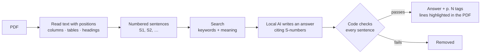

<p align="center">
  
</p>

<h1 align="center">Underline</h1>

<p align="center">
  <strong>Ask your documents. See the proof.</strong><br>
  Private, offline answers from your PDFs, where every sentence is checked and the source lines are highlighted.
</p>

<p align="center">
  
  
  
  
</p>

<p align="center">
  
</p>

---

## Why Underline

Insurance policies, rent agreements, offer letters and HR rules are exactly the documents you **should not upload** to a chatbot. They hold your salary, your health and your address. And when an AI answers a question about them, you still don't know if the answer is true.

Underline fixes both problems:

- 🔒 **Secure by design: nothing leaves your computer.** The PDF, the search index and the AI model all run locally. There is no server, no account, no analytics and no cloud AI. A strict Content Security Policy only lets the page talk to itself and the AI engine on your own machine.
- 📴 **Fully offline.** After the first start, it works with Wi-Fi turned off: the app, its search model and the PDF engine are served from your computer and cached by a service worker.
- ✅ **Every answer is checked by code.** The AI must cite the sentences it used. The checker then tests every answer sentence against those citations: numbers, months, key words, "not", exclusions, and whether a number really belongs to the thing you asked about. Sentences that fail are removed, not shown.
- 🖍️ **Proof you can see.** Each sentence has a `p. 12` tag. Click it and the exact lines are highlighted in the PDF.
- 🙅 **It says "not found" instead of guessing.** Ask about something the document doesn't cover and you get "I couldn't find this", plus the closest lines to read yourself.

## How it works



**The AI proposes, the code verifies.** The model is small and runs on a normal laptop (Gemma 4 E2B, about 2.2 GB of memory). The trust comes from the checker, not from the model being big.

## How accurate is it?

Measured on **8 documents the app had never seen** (Indian health insurance policies, Australian tenancy agreements, university leave rules): 112 questions, including 22 trick questions whose answer is *not* in the document. Every kept sentence was reviewed by hand.

| | Result |
|---|---|
| Questions answered correctly, with proof | **84%** (76 of 90) |
| Wrong sentences that slipped past the checker | **2** (out of ~110 shown) |
| Trick questions correctly answered "not found" | **19 of 22** |
| Time to first word (8 GB M2 MacBook) | **~4 s** |

The full method, every model tried (Qwen 3.5, Phi-4 mini, Granite 4.2, Gemma 4 E2B/E4B) and every mistake are written up in [docs/RESULTS.md](docs/RESULTS.md).

## Quick start

You need **Node 22+** and, for AI answers, the free **[Ollama](https://ollama.com)** app.

```bash
git clone https://github.com/umangbagadi03/underline.git
cd underline
npm install
npm run dev
```

Open **http://localhost:5173**. The first start copies the search model and PDF engine into `public/` (about 120 MB, once).

- If Ollama is running, Underline finds it. If the AI model is missing, click **Download AI model** in the sidebar (Gemma 4 E2B, 3.6 GB, once).
- Without Ollama, Underline still works in **search-only** mode: it shows the best matching lines with page tags.
- Also works with llama.cpp's `llama-server` on port 8080.

Production build (adds the security policy and offline mode):

```bash
npm run build
npx vite preview   # http://localhost:4173
```

## Features

- **Library on your device.** Documents are saved in the browser's local database (IndexedDB). Reopening is instant, chat history included.
- **Smart PDF reading.** Two-, three- and four-column pages are read column by column. Tables with drawn borders are read cell by cell. Repeating headers and footers are removed.
- **Hybrid search.** Keyword search (MiniSearch) plus meaning search (bge-small embeddings on WebGPU), fused together.
- **Three honest answer states.** *Verified*, *Not found exactly, here are related lines*, and *Not found*.
- **Light and dark mode**, and a layout that works on a phone.

## Privacy and security details

| What | Where it runs |
|---|---|
| Your PDF | Stays in your browser (IndexedDB). Never uploaded. |
| PDF reading | pdf.js, served by the app itself |
| Search model (bge-small, ~120 MB) | In your browser, files served by the app itself |
| AI model | Ollama or llama.cpp on your own computer (`localhost`) |
| Network | A Content Security Policy allows only the app itself and the local AI engine. No analytics, no third-party requests. |

## Project structure

| Folder | What's inside |
|---|---|
| `src/pdf/` | Read PDF text with positions; columns, tables, headings, sentences |
| `src/search/` | Keyword + meaning search, local model setup |
| `src/answer/` | Prompt, local AI engine (OpenAI-style API), model download |
| `src/verify/` | **The checker**: citations, numbers, key words, "not", exclusions, number ↔ subject |
| `src/store/` | Saving documents on the device |
| `src/app/` | The app screens |
| `eval/` | Test questions, eval runner, hand-review labels, results |
| `tests/` | Unit tests (`npm test`) |

## Tests and evaluation

```bash
npm test                                   # unit tests
node eval/run-eval.js --provider local \
  --model hf.co/unsloth/gemma-4-E2B-it-qat-GGUF:UD-Q4_K_XL \
  --questions eval/questions-holdout.json  # held-out eval
node eval/summarize.js --questions eval/questions-holdout.json
```

The third-party test PDFs are **not included** in this repo (copyright). Each one is listed with its public source link in `eval/questions.json` and `eval/questions-holdout.json`; download them into `eval/docs/` and `eval/docs-holdout/` to re-run the eval. The synthetic offer letter is included.

## Known limits

- Scanned PDFs (images with no text layer) are not supported yet. OCR would be needed.
- English only (the search model is English).
- If the app is hosted on a website instead of `localhost`, Ollama needs `OLLAMA_ORIGINS` set to allow it.
- The checker catches most wrong sentences, not all: about 2 in 100 still get through. Always click the page tag for anything important.
