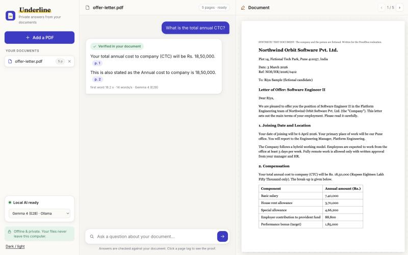
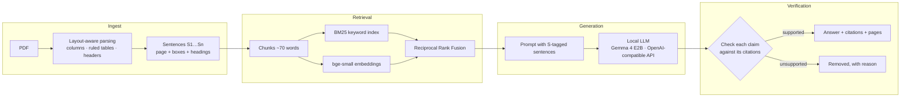
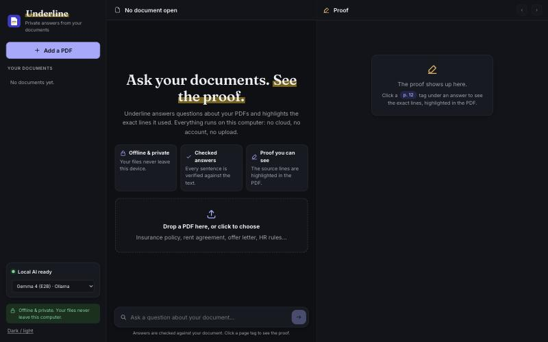
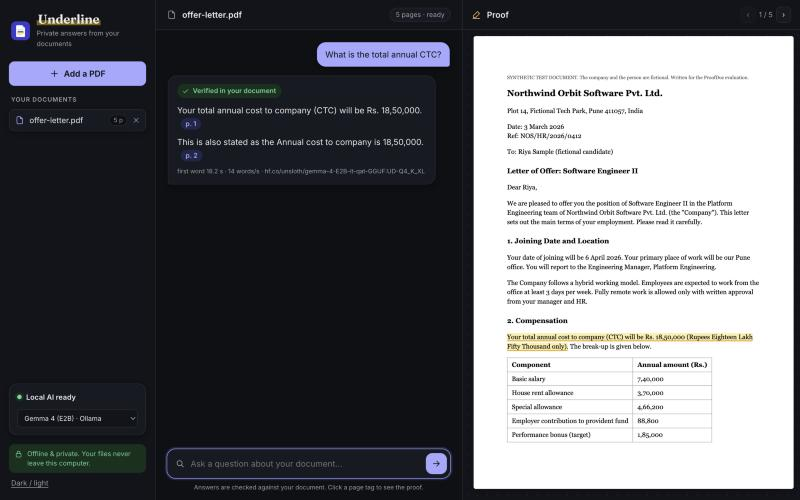

<p align="center">
  
</p>

<h1 align="center">Underline</h1>

<p align="center">
  <strong>A fully offline RAG engine for PDFs that refuses to make things up.</strong><br>
  Hybrid retrieval · grounded generation with a local LLM · a code verifier that removes every unsupported sentence.
</p>

<p align="center">
  
  
  
  
</p>

<p align="center">
  
  <br><sub>Every sentence is checked against the document. Click <code>p. 1</code> and the source line is highlighted in the PDF.</sub>
</p>

---

## What it is

Ask a question about a PDF (an insurance policy, a tenancy agreement, HR rules) and get an answer where **every sentence is cited and checked** against the document. Sentences the document doesn't support are removed before you see them. If the answer isn't in the document, it says so.

It all runs on your machine: PDF parsing, embeddings, vector search, the LLM. **No cloud API, no data leaves the computer.**

Three ways to use the same engine:

| | |
|---|---|
| **REST API**: `npm run serve` | Upload PDFs, ask questions, get verified answers with citations and highlight boxes as JSON |
| **CLI**: `npm run ask -- file.pdf "question"` | One-shot answers in the terminal |
| **Web app**: `npm run dev` | Chat UI with the proof highlighted in the PDF |

## RAG architecture



| Stage | Techniques | Code |
|---|---|---|
| **Ingest** | Layout-aware PDF parsing: recursive column detection, ruled-table cell extraction from vector drawings, header/footer removal, sentence segmentation with heading context | [`rag/ingest/`](rag/ingest) |
| **Retrieval** | Hybrid search: BM25 (MiniSearch) + dense vectors (bge-small-en-v1.5, ONNX, int8/fp16), fused with Reciprocal Rank Fusion | [`rag/retrieval/`](rag/retrieval) |
| **Generation** | Grounded prompting with sentence IDs, forced citations, explicit `NOT FOUND`; streaming client for any OpenAI-compatible local server; 4-bit GGUF model | [`rag/generation/`](rag/generation) |
| **Verification** | Claim-level hallucination guard: citation validity, number/date matching, key-word overlap, negation, exclusion conflicts, number ↔ subject anchoring, pronoun links. Experimental NLI cross-encoder | [`rag/verification/`](rag/verification) |
| **Evaluation** | Held-out test set, every kept sentence hand-labelled, offline re-scoring, 7 LLMs compared | [`eval/`](eval), [`docs/RESULTS.md`](docs/RESULTS.md) |

A detailed walk-through of each stage is in [`rag/README.md`](rag/README.md).

## Evaluation

Measured on **8 documents the engine had never seen** (Indian health insurance policies, Australian tenancy agreements, university leave rules): 112 questions, 22 of them unanswerable on purpose. Every kept sentence was reviewed by hand.

| Metric | Result |
|---|---|
| Answered correctly, with citations | **84%** (76 / 90) |
| Unsupported sentences that got past the verifier | **2** of ~110 |
| Unanswerable questions correctly refused | **19 / 22** |
| Time to first token (8 GB M2 laptop, CPU embeddings) | **~4 s** |

**What moved the numbers** (all in [docs/RESULTS.md](docs/RESULTS.md)):
- **The verifier does real work.** On the held-out run it removed 24 sentences that their cited text didn't back up. The most common cause, at 11, was a correct-looking number taken from the wrong clause. A few removed sentences were right but loosely worded; that is the price of strictness.
- **Parsing fixes beat prompt and model changes.** Reading columns and ruled tables correctly took the answer rate from 81% to 84% and unsupported sentences from 3 to 2.
- Model choice: Gemma 4 E2B beat Qwen 3.5 (2B/4B), Granite 4.2 3B and Phi-4 mini on accuracy *and* speed. Gemma 4 E4B was about as accurate but 3× slower.
- Runtime matters on small machines: Qwen 3.5 2B used 1.6 GB as a GGUF on llama.cpp, against 7.9 GB on Ollama's MLX runner.

## Quick start

Needs **Node 22+** and **[Ollama](https://ollama.com)** (or llama.cpp's `llama-server`).

```bash
git clone https://github.com/umangbagadi03/underline.git
cd underline
npm install
npm run setup                     # embedding model + parser data into public/ (~120 MB, once)
ollama pull hf.co/unsloth/gemma-4-E2B-it-qat-GGUF:UD-Q4_K_XL    # 3.6 GB, once
```

### CLI

```bash
npm run ask -- offer-letter.pdf "How long is the probation period?"
```
```
offer-letter.pdf: 5 pages, 87 sentences indexed

✓ Verified in the document

  You will be on probation for a period of 6 months from your date of joining.  [p. 3]
  The probation period may be extended by up to 3 more months if your performance needs improvement.  [p. 3]
```

Flags: `--model <name>`, `--search-only` (no LLM, just the best passages), `--json`.

### REST API

```bash
npm run serve          # http://127.0.0.1:8787 (listens on localhost only)
```

| Method | Path | Body | Returns |
|---|---|---|---|
| `GET` | `/health` | | LLM status, model, whether vector search is on |
| `POST` | `/documents` | PDF bytes (`X-Filename` header optional) | `{ id, name, pages, sentences, indexMs }` |
| `GET` | `/documents` | | indexed documents |
| `POST` | `/documents/:id/ask` | `{ "question": "...", "model"?: "...", "searchOnly"?: true }` | verified answer (below) |
| `DELETE` | `/documents/:id` | | `{ deleted }` |

```bash
ID=$(curl -s -X POST localhost:8787/documents --data-binary @offer-letter.pdf | jq -r .id)
curl -s -X POST localhost:8787/documents/$ID/ask -d '{"question":"What is the notice period after confirmation?"}'
```
```json
{
  "status": "answered",
  "answer": [
    {
      "text": "After confirmation, the notice period is 60 days.",
      "citations": [
        { "id": "S46", "page": 3, "text": "After confirmation, the notice period is 60 days.",
          "boxes": [{ "x": 179, "y": 597, "w": 261, "h": 13 }] }
      ]
    },
    {
      "text": "The Company may also accept payment of basic salary in lieu of the notice period.",
      "citations": [
        { "id": "S47", "page": 3, "text": "The Company may, at its sole discretion, accept payment of basic salary in lieu of the notice period.",
          "boxes": [{ "x": 445, "y": 597, "w": 85, "h": 13 }, { "x": 62, "y": 580, "w": 417, "h": 13 }] }
      ]
    }
  ],
  "removed": [],
  "passages": [],
  "model": "hf.co/unsloth/gemma-4-E2B-it-qat-GGUF:UD-Q4_K_XL",
  "timings": { "retrieveMs": 185, "firstTokenMs": 411, "totalMs": 2799 }
}
```

`status` is `answered`, `related` (only nearby facts were found), `not-found` (with the closest `passages`) or `search-only`. `removed` lists the sentences the verifier threw out and why. Configure with `PORT`, `UNDERLINE_MODEL` and `UNDERLINE_LLM_URL`.

### Web app

```bash
npm run dev            # http://localhost:5173
```

A chat client for the same engine, running fully in the browser (embeddings on WebGPU). Click a `p. 12` tag to see the proof highlighted in the PDF (screenshot at the top). Light and dark themes:

<p align="center">
  
  
</p>

## Privacy and security

- **Nothing leaves the machine.** Parsing, embeddings, vector search and the LLM all run locally. No cloud API, no telemetry.
- The API binds to `127.0.0.1` only, checks uploads are real PDFs and caps them at 50 MB.
- The web app ships a strict Content Security Policy (only itself and the local LLM), self-hosts every model and font, and works offline through a service worker.
- Model files are loaded from disk only. Remote model downloads are switched off at run time.

## Project structure

```
rag/                 the RAG engine (no UI code)
  ingest/            PDF → sentences: columns, ruled tables, headers, headings
  retrieval/         chunks, BM25, embeddings, Reciprocal Rank Fusion
  generation/        grounded prompt, OpenAI-compatible local LLM client, model setup
  verification/      claim-level hallucination guard (+ experimental NLI)
  pipeline.js        indexPdf() and answerQuestion()
server/              REST API (node:http, no framework) and the shared Node engine
bin/                 CLI
eval/                eval runner, grader, offline re-scorer, questions, hand labels, results
tests/               unit + API tests (vitest)
src/                 web client (UI, PDF viewer, on-device storage)
docs/                results write-up, design plan, screenshots
```

## Tests and evaluation

```bash
npm test                                                   # 65 unit + API tests
node eval/run-eval.js --provider local \
  --model hf.co/unsloth/gemma-4-E2B-it-qat-GGUF:UD-Q4_K_XL \
  --questions eval/questions-holdout.json                  # run the held-out eval
node eval/summarize.js --questions eval/questions-holdout.json   # score against hand labels
```

The third-party test PDFs are **not included** (copyright). Their public sources are listed in `eval/questions.json` and `eval/questions-holdout.json`. The synthetic offer letter is included.

## Limits

- Scanned PDFs (no text layer) need OCR, which isn't built in yet.
- English only (the embedding model is English).
- The verifier catches most unsupported sentences, not all: about 2 in 100 still get through. Check the cited page for anything important.


<div align="center"><sub>Built by <a href="https://github.com/umangbagadi03">Umang Bagadi</a></sub></div>


